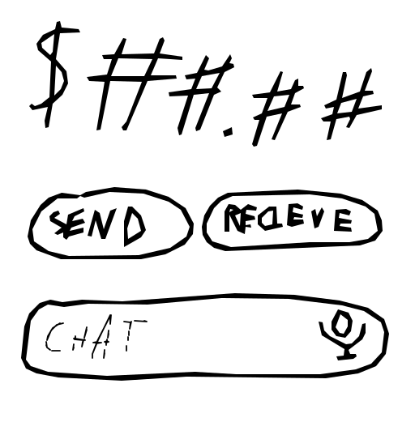

# PhishNet — User-Supplied PWA UI Concepts

These are **concept drawings**, not final designs or a request to introduce new branding.

## Concept 01 — Wallet and generic chat

**Image status:** A vector trace of the first uploaded sketch. The original was a bitmap supplied in the conversation; this version was traced at reduced resolution for GitHub display, and should not be presented as the exact original pixels.

Source-observed information: large balance at top; two prominent rounded **SEND** and **RECEIVE** buttons; large rounded plain **CHAT** field; microphone graphic at right. No “Ask PhishNet” prompt. The drawing intentionally keeps the main payments experience uncluttered.

## Concept 02 — Wallet + persistent bottom navigation

The second sketch uploaded in the conversation shows the same top balance, Send/Receive, and Chat field, plus a horizontal separator with **four unlabeled icons** at the bottom. The rendered sketch visibly suggests wallet/account, activity or notes, a connected-node knowledge graph, and settings. **These semantic names are our proposed interpretation, not labels written on the original.**

The second screenshot's underlying file bytes were not accessible in the runtime provided for this task. **Its original image has therefore not been uploaded**, and no invented substitute image is labeled as the original. Reattach the second file to replace this note with a faithful upload.

### Recommended implementation interpretation (subject to UX testing)

| Visual region | UI behavior |
|---|---|
| Large top balance | Selected wallet + Arc Testnet balance and network clarity |
| SEND | Opens canonical transaction form and external-wallet confirmation |
| RECEIVE | Full copyable address / QR; indicate indexing completeness for received transfers |
| CHAT + microphone illustration | Generic Chat input; mic only if voice capability and permissions are genuinely implemented |
| Bottom icon 1 | Wallet |
| Bottom icon 2 | Activity |
| Bottom icon 3 | Graph |
| Bottom icon 4 | Settings |

Keep Chat available on the main wallet screen. A separate full-screen chat conversation or sheet is reasonable on larger screens; don't create a branded AI persona by default. Accessibility requires textual navigation labels, touch targets and focus order even if the visual sketch uses icons only.

The graph's **Transaction Flow** and **Decision History** layers must each have independent show/hide controls; the PWA may show both or neither. See [MVP scope](../mvp-scope.md).

## Design provenance

Original design authored by the project owner and supplied directly in chat (November 26, 2026). This folder contains project-specific implementation guidance and one vector-traced reproduction; it is not a licensed third-party design kit.
