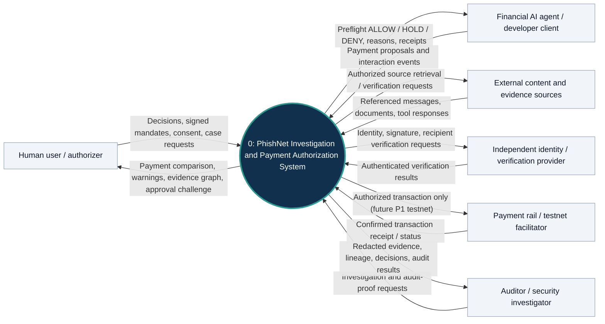
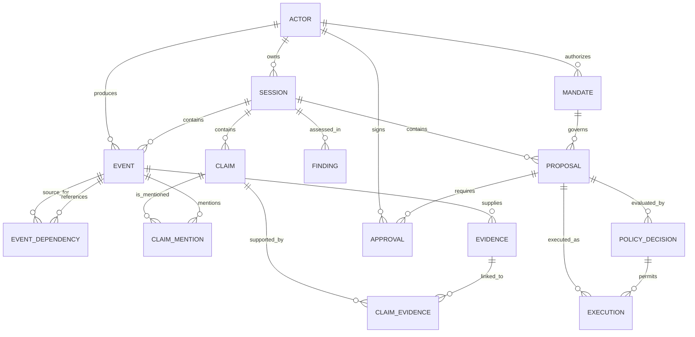
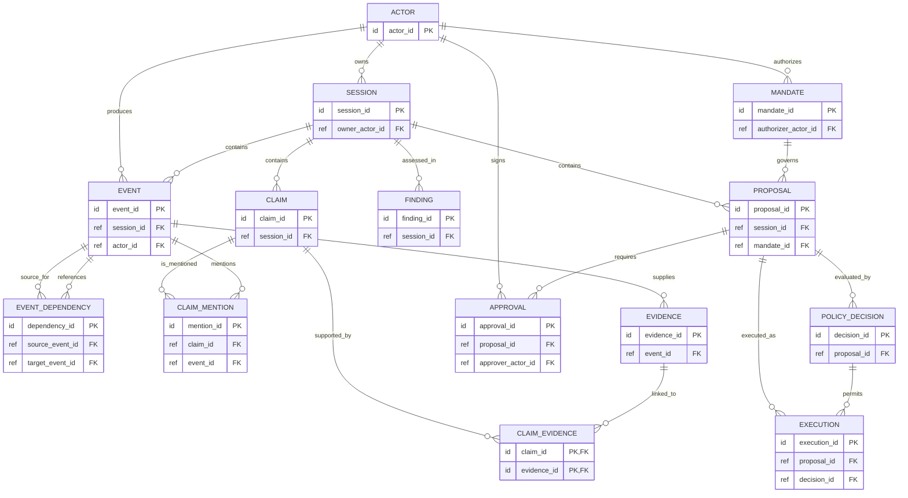
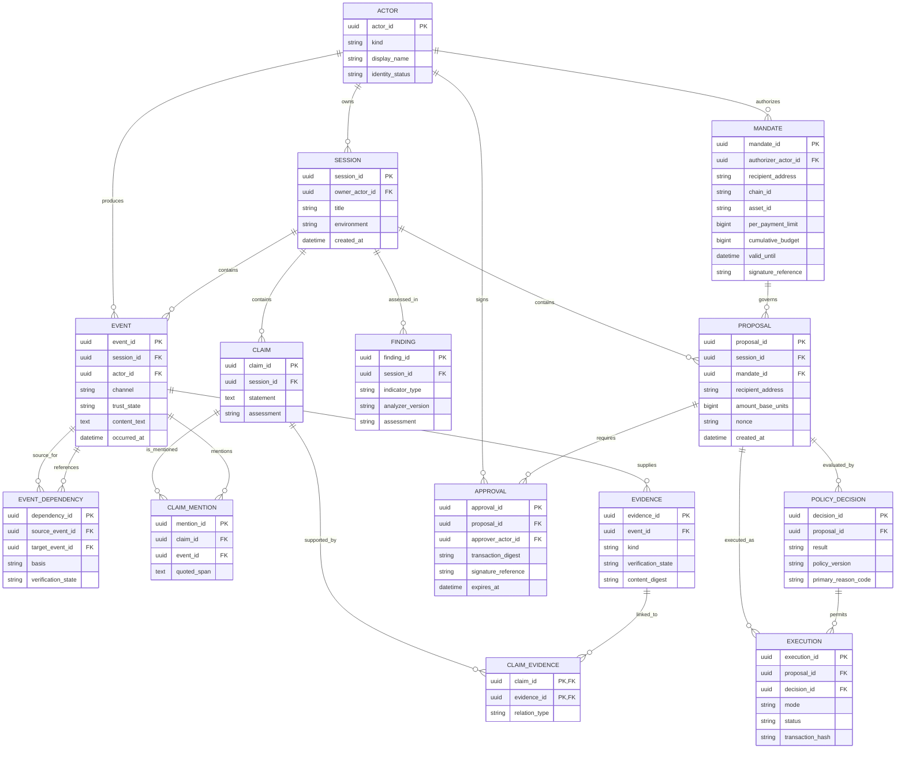

# PhishNet — Diagrams (live Mermaid previews)

These diagrams are **progressively detailed design views** rather than three proofs of relational normalization. See [normalization.md](normalization.md). GitHub renders them automatically; editable source files are [dfd-level-0.mmd](dfd-level-0.mmd), [erd-1nf.mmd](erd-1nf.mmd), [erd-2nf.mmd](erd-2nf.mmd), [erd-3nf.mmd](erd-3nf.mmd).

## Level 0 DFD: PhishNet as one system process

## 1NF view: entities and crow's-foot relationships only

## 2NF view: identifiers, PKs and FK references

## 3NF view: attributes and illustrative datatypes

