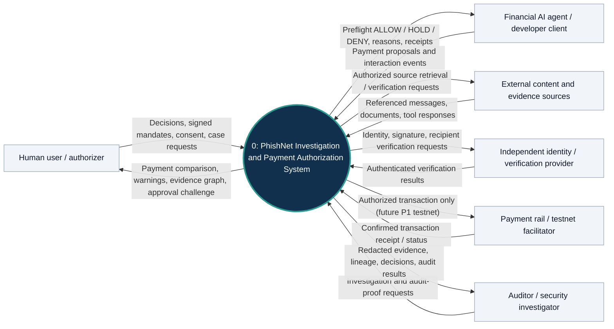
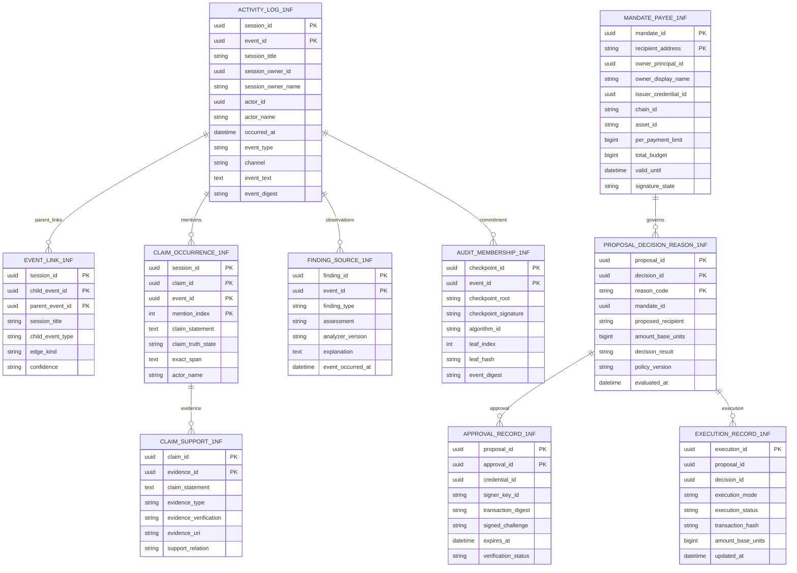
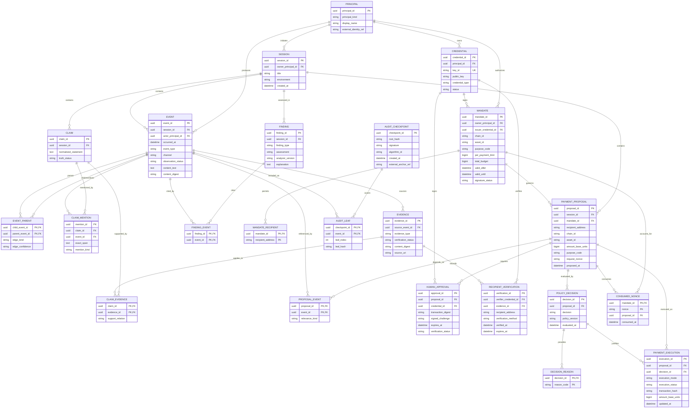

# PhishNet Data and Process Diagrams

Editable source files are linked from [README.md](README.md). GitHub renders the Mermaid blocks below. `1NF` and `2NF` are **instructional**, and `3NF` is a **proposed implementation target**.

## Level 0 context data-flow diagram

## First normal form (1NF)

## Second normal form (2NF)

```mermaid
%% PhishNet second normal form (2NF): partial-key dependencies removed, transitive ones retained
%% Source of truth is normalization.md for functional dependencies; instructional model, not current database.
erDiagram
    PRINCIPAL_2NF {
        uuid principal_id PK
        string principal_kind
        string display_name
        string external_identity_ref
    }
    CREDENTIAL_2NF {
        uuid credential_id PK
        uuid principal_id FK
        string key_id UK
        string public_key
        string credential_type
        string status
    }
    SESSION_2NF {
        uuid session_id PK
        uuid owner_principal_id FK
        string owner_display_name
        string title
        string environment
        datetime created_at
    }
    EVENT_2NF {
        uuid event_id PK
        uuid session_id FK
        uuid actor_principal_id FK
        string actor_display_name
        datetime occurred_at
        string event_type
        string channel
        string observation_status
        text content_text
        string content_digest
    }
    EVENT_PARENT_2NF {
        uuid child_event_id PK,FK
        uuid parent_event_id PK,FK
        string edge_kind
        string edge_confidence
    }
    CLAIM_2NF {
        uuid claim_id PK
        uuid session_id FK
        text normalized_statement
        string truth_status
    }
    CLAIM_MENTION_2NF {
        uuid mention_id PK
        uuid claim_id FK
        uuid event_id FK
        text exact_span
        string mention_kind
    }
    EVIDENCE_2NF {
        uuid evidence_id PK
        uuid source_event_id FK
        string evidence_type
        string verification_status
        string content_digest
        string source_uri
    }
    CLAIM_EVIDENCE_2NF {
        uuid claim_id PK,FK
        uuid evidence_id PK,FK
        string support_relation
    }
    FINDING_2NF {
        uuid finding_id PK
        uuid session_id FK
        string finding_type
        string assessment
        string analyzer_version
        text explanation
    }
    FINDING_EVENT_2NF {
        uuid finding_id PK,FK
        uuid event_id PK,FK
    }
    MANDATE_2NF {
        uuid mandate_id PK
        uuid owner_principal_id FK
        string owner_display_name
        uuid issuer_credential_id FK
        string chain_id
        string asset_id
        string purpose_code
        bigint per_payment_limit
        bigint total_budget
        datetime valid_after
        datetime valid_until
        string signature_status
    }
    MANDATE_RECIPIENT_2NF {
        uuid mandate_id PK,FK
        string recipient_address PK
    }
    PAYMENT_PROPOSAL_2NF {
        uuid proposal_id PK
        uuid session_id FK
        uuid mandate_id FK
        string recipient_address
        string chain_id
        string asset_id
        bigint amount_base_units
        string purpose_code
        string request_nonce
        datetime proposed_at
    }
    PROPOSAL_EVENT_2NF {
        uuid proposal_id PK,FK
        uuid event_id PK,FK
        string relevance_kind
    }
    HUMAN_APPROVAL_2NF {
        uuid approval_id PK
        uuid proposal_id FK
        uuid credential_id FK
        string signer_key_id
        string transaction_digest
        string signed_challenge
        datetime expires_at
        string verification_status
    }
    RECIPIENT_VERIFICATION_2NF {
        uuid verification_id PK
        uuid verifier_credential_id FK
        uuid evidence_id FK
        string recipient_address
        string verification_method
        datetime verified_at
        datetime expires_at
    }
    POLICY_DECISION_2NF {
        uuid decision_id PK
        uuid proposal_id FK
        string proposal_recipient_address
        string decision
        string policy_version
        datetime evaluated_at
    }
    DECISION_REASON_2NF {
        uuid decision_id PK,FK
        string reason_code PK
    }
    PAYMENT_EXECUTION_2NF {
        uuid execution_id PK
        uuid proposal_id FK
        uuid decision_id FK
        string execution_mode
        string execution_status
        string transaction_hash
        bigint amount_base_units
        datetime updated_at
    }
    CONSUMED_NONCE_2NF {
        uuid mandate_id PK,FK
        string nonce PK
        uuid proposal_id FK
        datetime consumed_at
    }
    AUDIT_CHECKPOINT_2NF {
        uuid checkpoint_id PK
        string root_hash
        string signature
        string algorithm_id
        datetime created_at
        string external_anchor_ref
    }
    AUDIT_LEAF_2NF {
        uuid checkpoint_id PK,FK
        uuid event_id PK,FK
        int leaf_index
        string leaf_hash
    }
    PRINCIPAL_2NF ||--o{ CREDENTIAL_2NF : owns
    PRINCIPAL_2NF ||--o{ SESSION_2NF : initiates
    PRINCIPAL_2NF ||--o{ EVENT_2NF : produces
    SESSION_2NF ||--o{ EVENT_2NF : contains
    EVENT_2NF ||--o{ EVENT_PARENT_2NF : child
    EVENT_2NF ||--o{ EVENT_PARENT_2NF : parent
    SESSION_2NF ||--o{ CLAIM_2NF : contains
    CLAIM_2NF ||--o{ CLAIM_MENTION_2NF : mentioned_by
    EVENT_2NF ||--o{ CLAIM_MENTION_2NF : mentions
    EVENT_2NF ||--o{ EVIDENCE_2NF : sources
    CLAIM_2NF ||--o{ CLAIM_EVIDENCE_2NF : supported_by
    EVIDENCE_2NF ||--o{ CLAIM_EVIDENCE_2NF : applies_to
    SESSION_2NF ||--o{ FINDING_2NF : assessed_in
    FINDING_2NF ||--o{ FINDING_EVENT_2NF : cites
    EVENT_2NF ||--o{ FINDING_EVENT_2NF : cited_by
    PRINCIPAL_2NF ||--o{ MANDATE_2NF : authorizes
    CREDENTIAL_2NF ||--o{ MANDATE_2NF : signs
    MANDATE_2NF ||--o{ MANDATE_RECIPIENT_2NF : permits
    SESSION_2NF ||--o{ PAYMENT_PROPOSAL_2NF : contains
    MANDATE_2NF ||--o{ PAYMENT_PROPOSAL_2NF : governs
    PAYMENT_PROPOSAL_2NF ||--o{ PROPOSAL_EVENT_2NF : depends_on
    EVENT_2NF ||--o{ PROPOSAL_EVENT_2NF : referenced_by
    PAYMENT_PROPOSAL_2NF ||--o{ HUMAN_APPROVAL_2NF : requires
    CREDENTIAL_2NF ||--o{ HUMAN_APPROVAL_2NF : signs
    CREDENTIAL_2NF ||--o{ RECIPIENT_VERIFICATION_2NF : verifies
    EVIDENCE_2NF ||--o{ RECIPIENT_VERIFICATION_2NF : records
    PAYMENT_PROPOSAL_2NF ||--o{ POLICY_DECISION_2NF : evaluated_by
    POLICY_DECISION_2NF ||--o{ DECISION_REASON_2NF : provides
    PAYMENT_PROPOSAL_2NF ||--o{ PAYMENT_EXECUTION_2NF : executed_as
    POLICY_DECISION_2NF ||--o{ PAYMENT_EXECUTION_2NF : justifies
    MANDATE_2NF ||--o{ CONSUMED_NONCE_2NF : accounts_for
    PAYMENT_PROPOSAL_2NF ||--o{ CONSUMED_NONCE_2NF : consumes
    AUDIT_CHECKPOINT_2NF ||--o{ AUDIT_LEAF_2NF : covers
    EVENT_2NF ||--o{ AUDIT_LEAF_2NF : included_as
```

## Third-normal-form-oriented target

